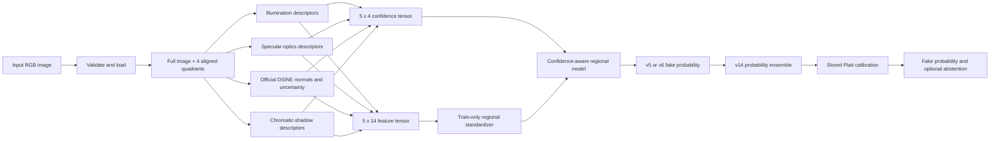

# Complete Project Handoff: Physics-Inspired AI-Image Detection

**Project root:** `G:\Thesis\pipeline_40k`
**Repository:** <https://github.com/Mahim25800/Thesis-model>
**Branch and recorded revision:** `main`, `7b6b8c3513103599b3d61126a5f3f6e98f013cdb`
**Handoff date:** 2026-09-25
**Scope rule:** work only in `pipeline_40k` unless the project owner explicitly changes scope.

---

## 1. Purpose and current conclusion

This thesis project tests whether compact, interpretable image measurements inspired by scene physics can distinguish camera-origin images from AI-generated images across generators not used during training.

The project has produced a rigorous **regional multi-physics detector**, a frozen external evaluation, a local image-testing interface, and a new robustness-improvement experiment. It has **not** produced a universal or forensic deepfake detector.

The strongest released artifact is **Physics Ensemble v14**. It is the project’s best model on the nine-generator Synthbuster benchmark, with **0.7024 mean ROC-AUC**, but its disjoint GenImage confirmation AUC is **0.6239**. The correct thesis claim is therefore:

> Regional physics-inspired features and generator-invariant training improved this project’s prior global physics baseline on Synthbuster, while independent confirmation showed a material cross-dataset generalization limit.

The latest v16 experiment improves the **worst generator-held-out development AUC** from **0.6322** to **0.6566** through training-only JPEG, blur, and resize augmentation. It is promising but is **not yet a released replacement for v14** and must not be selected using previously opened Synthbuster or confirmation labels.

---

## 2. What is complete now

| Area | Status | Main evidence |
|---|---|---|
| Physics pipeline | Complete | Four confidence-gated entities in five image regions, using official DSINE normal estimation. |
| v14 frozen release | Complete and pushed | `models/physics_ensemble_v14/` and Git commits `4071102`, `f2a7ee2`, `43fd29d`. |
| Internal, Synthbuster, and confirmation evaluation | Complete | v14 JSON evaluations and per-image predictions. |
| v14 entity/region/branch audit | Complete | `models/physics_ensemble_v14/robustness_audit.json`. |
| Rotated held-generator selection protocol | Complete | `models/multi_generator_v16_control/selection_summary.json`. |
| Training-only raw-image augmentation | Complete | Augmentation cache builder plus v16 augmented selection results. |
| Local UI for one-image inspection | Complete | `demo_v14/app.py`; run locally on port 7860. |
| v15 physics-plus-projective-geometry experiment | Complete negative result | Good internal performance but weak external transfer; do not promote. |
| Direct v5 illumination full/masked/dropout comparison | Not run | Next pre-specified physics-only experiment. |
| Improved v6/ensemble selection under the new protocol | Not run | Must follow the illumination result. |
| Fresh protected external final holdout | Not created | Required before any new generalization or breakthrough claim. |
| Semantic hybrid, e.g. CLIP/DINO + physics | Not started | Separate future baseline; it changes the pure-physics thesis claim. |

---

## 3. Research design and integrity rules

### 3.1 What counts as training, selection, calibration, and testing

The project separates the following roles. Do not collapse them.

| Data role | Use | Must not be used for |
|---|---|---|
| Internal fitting partition | Fit feature standardizer and classifier weights | Reported final performance or threshold fitting. |
| Internal development partition | Early stopping and architecture comparison | Calibration or final reporting. |
| Internal calibration partition | Platt calibration, decision threshold, abstention band | Architecture, branch weight, or augmentation selection. |
| Internal unseen test | Report post-selection internal result | Any model or threshold choice. |
| GenImage source domains | v6 source-domain training | Held-generator development for their own fold. |
| Held GenImage generator | Development selection for the matching fold | Gradient updates for that fold. |
| Synthbuster | Frozen external descriptive/final benchmark | Any new model, threshold, blend, or augmentation choice. |
| First disjoint GenImage confirmation | Previously opened confirmation result | Any subsequent model choice. |
| Future fresh external holdout | One final, pre-registered evaluation | All design, selection, and calibration decisions. |

### 3.2 Leakage controls

- Image SHA-256 hashes and 64-bit difference hashes are recorded in cache manifests.
- Group-disjoint splits use difference-hash groups, keeping visually similar examples out of different fitting, development, calibration, and test partitions.
- Train-only standardization stores statistics from fitting rows only.
- v14 calibration is fit after branch/weight selection; it is not fit on Synthbuster or confirmation data.
- The original confirmation set uses GenImage archive positions 4,001–6,000 and excludes two conservative perceptual-hash overlaps with protected data.
- The v16 rotated protocol ranks candidates by their **minimum held-generator AUC**, then the mean AUC. It does not read Synthbuster or confirmation labels.

### 3.3 Why this matters

A high internal score or a result on one held generator can be a generator-specific shortcut. The disjoint GenImage confirmation showed exactly this risk: v14 was strong on Synthbuster but did not transfer as well to a different set of generator families. Any future model must earn its claim on a fresh final holdout after design choices stop.

---

## 4. End-to-end system architecture



### 4.1 Input regions and entities

Every image produces five spatial regions:

```text
global, top_left, top_right, bottom_left, bottom_right
```

Every region has 14 feature values and four confidence values:

| Physics-inspired entity | Dimensions | Implementation | Meaning of confidence |
|---|---:|---|---|
| Illumination consistency | 5 | `src/extractors/illumination_sh.py` | Availability/stability of illumination evidence. |
| Specular optics | 4 | `src/extractors/corneal_optics.py` | Availability of scene-wide highlight evidence. |
| Surface-normal consistency | 3 | `src/extractors/surface_normals.py` and DSINE | Reliability of DSINE normal/concentration evidence. |
| Chromatic shadows | 2 | `src/extractors/chromatic_shadow.py` | Reliability of bright/dark chromatic evidence. |

The final cache schema is:

```text
regional_physics_dsine_v2_5x14_features_5x4_confidences
features:     [samples, 5, 14]
confidences:  [samples, 5, 4]
labels:       [samples]
```

These are **physics-inspired statistical descriptors**. No single feature establishes that a physical law was violated. The learned classifier decides from patterns and agreements among the features.

### 4.2 DSINE normal estimation

`src/extractors/dsine_normals.py` wraps the official DSINE `DSINE_v02_kappa` model. It:

1. loads a local official checkpoint rather than downloading at inference time;
2. validates the recorded checkpoint SHA-256;
3. estimates normals and DSINE concentration once for the full image;
4. summarizes aligned normal/shading residuals inside the global region and four quadrants;
5. returns three surface-normal features plus a confidence derived from DSINE concentration and image contrast.

Local checkpoint path:

```text
models/normal_estimators/dsine/exp002_kappa/dsine.pt
```

Recorded official checkpoint hash:

```text
1BDDAE86D7D8F59912C50F3164C2543B1B80FDADFBF1C5DD0AB2D85108BBA955
```

The DSINE source and local runtime package are under `third_party/DSINE/` and `third_party/python_packages/`. These large assets are intentionally not part of the Git release; a clone that needs raw-image extraction must supply them and verify the checkpoint provenance.

### 4.3 Regional model architecture

`src/models/regional_multi_physics.py` implements `RegionalMultiPhysicsHead`:

1. Each entity is independently encoded together with its confidence.
2. Low-confidence evidence is replaced by a learned missing-cue token, rather than being treated as a valid numerical zero.
3. Six pairwise entity interactions are encoded for every region.
4. Pair attention is confidence weighted.
5. Entity and pair summaries become five regional tokens.
6. A two-layer transformer compares the five regions.
7. The global token and attention-pooled regional token are concatenated to produce a fake-image logit.

The regional loss combines the main classification loss with light entity, region, and spatial-attention diversity supervision.

### 4.4 v5 and v6 difference

| Branch | What it adds | Intended benefit |
|---|---|---|
| v5 regional physics | Five-region regional transformer and pairwise interactions | Learn local contradictions and cross-region disagreement. |
| v6 generator invariant | The same regional architecture plus gradient reversal and a source-domain classifier | Suppress generator-specific information in the learned representation. |

The domain classifier is in `scripts/train_generator_invariant_v6.py`. It receives the v6 embedding through a gradient-reversal layer. The classifier tries to identify the source domain, while the feature extractor learns a representation that makes this harder without losing fake/real discrimination.

### 4.5 Frozen v14 inference

`models/physics_ensemble_v14/model.pt` is an ensemble manifest, not a monolithic state dictionary. It validates branch SHA-256 hashes before inference.

| Branch | Location | Weight | Spatial inference |
|---|---|---:|---|
| `regional_v5_tta` | `models/region_tta_v13/regional_v5_tta/model.pt` | 0.70 | Identity plus horizontal, vertical, and 180-degree quadrant permutations averaged. |
| `generator_invariant_v6_tta` | `models/region_tta_v13/generator_invariant_v6_tta/model.pt` | 0.30 | Identity arrangement selected. |
| `physics_masked_v10` | `models/physics_masked_v10/model.pt` | 0.00 | Retained in manifest for auditability, not scored. |

The weighted raw fake probability is transformed to logits, passed through the stored Platt calibration policy, and then interpreted with the stored threshold and abstention band.

v14 policy in `models/physics_ensemble_v14/policy.json`:

| Field | Value |
|---|---:|
| Calibration method | Platt scaling |
| Calibration observations | 4,572 internal calibration rows |
| Fake decision threshold | 0.5589603971 |
| Abstain below / above | 0.4589603971 / 0.6589603971 |
| Probability label | `fake` |

ROC-AUC is the primary transfer metric. Do not interpret the calibrated decision threshold as portable to arbitrary sites, image distributions, or class ratios.

---

## 5. Data and cache map

The local raw datasets and generated feature caches are deliberately not pushed to GitHub. The following map tells a future researcher what each local location is for.

| Local location | Content and role |
|---|---|
| `data/scaled/train/` | Primary internal real/fake fitting source. 32,000 images: 16,000 real and 16,000 fake. |
| `data/scaled/test_unseen/` | Internal unseen set. 8,000 nominal rows before overlap exclusions. |
| `data/cache_regional_dsine_v2/` | Original regional DSINE cache for internal training and internal unseen testing. |
| `data/external_genimage_dev/selected/` | Selected GenImage ADM, BigGAN, VQDM, and Wukong domains. 2,000 real + 2,000 fake per domain. |
| `data/cache_genimage_regional_v2/` | Original regional DSINE cache for the four GenImage development domains. |
| `data/external_synthbuster/` | Frozen Synthbuster external benchmark source files. |
| `data/cache_synthbuster_regional_v2/` | Regional DSINE cache for Synthbuster; do not use to choose future models. |
| `data/external_genimage_confirmatory_disjoint/` | Previously opened disjoint GenImage confirmation data; do not use for new model selection. |
| `data/cache_genimage_confirmatory_disjoint_regional_v2/` | Cache used for the v14 confirmation; no longer an untouched final test. |
| `data/cache_regional_dsine_v16_augmented/` | Full 32,000-row deterministic augmented copy of internal fitting images. |
| `data/cache_genimage_regional_v16_augmented/` | Full deterministic augmented copy of four GenImage development domains. |

All caches record extraction provenance, feature schema, sample manifests, labels, file hashes, and difference hashes. The v16 augmentation manifests additionally record parent hash, parent group, transform kind and parameters, and deterministic seed.

---

## 6. Experiment history

| Stage | Change | Main result | Decision |
|---|---|---|---|
| Historical 40k baseline | Compact global classifier on the original cache | 71.79% internal accuracy, 0.7880 AUC | Starting point only; inadequate raw-image/cache provenance. |
| v3 multi-entity | Four entities and confidence-aware fusion | 73.23% internal accuracy, 0.8135 AUC | Demonstrated multi-entity signal; raw-image rebuild still required. |
| v4 DSINE global | Rebuilt features using official pretrained DSINE normals | 75.86% internal accuracy, 0.8404 AUC; 0.6232 Synthbuster mean AUC | Established reproducible external baseline. |
| v5 regional | Global region + four quadrants with regional transformer | 81.02% internal accuracy, 0.8920 AUC | Regional reasoning was useful. |
| v6 generator invariant | v5 architecture + GenImage domains + gradient reversal | 74.54% internal accuracy, 0.8249 AUC; 0.6297 Synthbuster mean AUC | Lower internal score, complementary generator-transfer behavior. |
| v7/v9/v11 ensemble work | Development-only mixtures of v5/v6 and variants | Wukong selected approximately 70% v5 / 30% v6 | Extra branches were not selected. |
| v8/v10/v12 ablations | Attention, illumination-disabled, and fixed-mask variants | Lower Wukong selection scores | Negative results, not promoted. |
| v13 TTA | Region permutation test-time averaging | Small Wukong gain for v5 | Included in v14 v5 branch. |
| **v14** | Freeze and calibrate 70/30 v5-TTA/v6 mixture | 0.7024 Synthbuster mean AUC | Strongest released model for Synthbuster. |
| v15 geometry | Add confidence-gated projective geometry entity | 81.73% / 0.8944 internal; 0.6262 Synthbuster mean AUC | Rejected: internal gain did not transfer. |
| v16 control | Rotated four-generator leave-one-domain-out v6 selection | Minimum AUC 0.6322; mean AUC 0.7434 | New selection baseline. |
| **v16 raw augmentation** | Append one deterministic raw-image JPEG, blur, or resize variant during fitting only | Minimum AUC 0.6566; mean AUC 0.7463 | Retain as a promising robustness candidate. |

The important negative result is v15: adding an apparently relevant geometry entity improved internal discrimination but weakened external transfer. This is why new features must be accepted by generator-held-out and fresh-external tests, not by internal AUC alone.

---

## 7. Frozen v14 results

### 7.1 Main performance

| Evaluation | Samples | Accuracy | ROC-AUC | Meaning |
|---|---:|---:|---:|---|
| Group-disjoint internal unseen | 7,992 | 80.31% | 0.8895 | Good source-family discrimination. |
| Synthbuster equal-generator mean | 18,000 | 63.51% | 0.7024 | Strongest project result on the primary external benchmark. |
| Disjoint GenImage confirmation mean | 7,998 | 58.28% | 0.6239 | Demonstrates cross-dataset generalization limit. |

Synthbuster per-generator AUC ranged from **0.6410 on Firefly** to **0.8310 on Stable Diffusion 2**. The original breakthrough gate required both mean AUC at least 0.70 and no generator below 0.65, so v14 did **not** pass because Firefly was below 0.65.

### 7.2 Confirmation result

| Frozen model | GLIDE | Midjourney | SD 1.4 | SD 1.5 | Mean AUC |
|---|---:|---:|---:|---:|---:|
| v14 ensemble | 0.7085 | 0.5709 | 0.6376 | 0.5785 | 0.6239 |
| v6 diagnostic branch | 0.7698 | 0.6177 | 0.6070 | 0.5376 | 0.6330 |

On this already-opened confirmation set, v6 exceeded v14 by 0.0091 mean AUC; the paired 95% bootstrap interval was `[0.0016, 0.0169]` in favor of v6. Do **not** replace v14 retroactively or tune a future model against this result. It is evidence that the original one-generator selection scheme was insufficient.

### 7.3 v14 versus earlier external baseline

The earlier global DSINE v4 model reached **0.6232 mean Synthbuster AUC**. v14 reached **0.7024**, an improvement of **+0.0783** with paired 95% bootstrap interval `[+0.0720, +0.0843]`. This supports the thesis claim that regional multi-physics fusion improved the project’s original global physics baseline on this benchmark.

---

## 8. v14 mechanism and shortcut audit

The full descriptive audit is saved in:

```text
models/physics_ensemble_v14/robustness_audit.json
reports/V14_V16_AUDIT_SUMMARY.md
```

The audit loads the actual v14 manifest, validates branch hashes, makes no model or policy changes, and measures the impact of removing an entity or region by zeroing its confidence.

### 8.1 AUC change when an entity or region is removed

Positive numbers below mean the full v14 model was better than the ablated version.

| Ablation | Internal unseen delta | Wukong development delta | Finding |
|---|---:|---:|---|
| Remove illumination | -0.0293 | -0.0435 | Helpful in both audited domains. |
| Remove specular optics | -0.0060 | -0.0357 | Small internally, useful on Wukong. |
| Remove surface normals | -0.1100 | -0.0153 | Dominant internal evidence; Wukong effect is uncertain. |
| Remove chromatic shadows | -0.0535 | -0.0757 | Strongest Wukong cue. |
| Global region only | -0.0839 | -0.0421 | Local quadrants add substantial signal. |
| Remove top-left quadrant | -0.0109 | -0.0110 | Small, reliable contribution. |
| Remove top-right quadrant | -0.0105 | -0.0129 | Small, reliable contribution. |
| Remove bottom-left quadrant | -0.0081 | +0.0042 | No reliable Wukong contribution. |
| Remove bottom-right quadrant | -0.0045 | +0.0038 | No reliable Wukong contribution. |

The bootstrap interval excludes zero for all listed internal entity ablations. For Wukong, the surface-normal and bottom-quadrant intervals include zero. This means v14 genuinely uses multiple entities and regions, but the relative value of those cues shifts across generator domains.

### 8.2 Branch relationship

The active v5-TTA/v6-TTA branch probability correlation is:

| Dataset | Correlation |
|---|---:|
| Internal unseen | 0.7924 |
| Wukong development | 0.6349 |

The branches are correlated but not redundant. This supports retaining a constrained ensemble only when it wins using permitted development data.

---

## 9. V16 multi-generator robustness work

### 9.1 Why v16 exists

v14 selected its blend using a single held-out generator, Wukong. The confirmation result showed that this was not broad enough. v16 replaces that scheme with a four-fold leave-one-generator-out protocol:

1. Pick ADM, BigGAN, VQDM, or Wukong as the held-out development generator.
2. Train v6 on the internal fitting rows plus the other three GenImage source domains.
3. Use the held-out generator for early stopping/model selection only.
4. Repeat for all four held-out roles.
5. Rank the experiment by minimum held-generator ROC-AUC, then mean held-generator ROC-AUC.

The runs use seeds `71, 73, 79`, maximum 120 epochs, patience 18, batch size 256, and domain-loss weight 0.10. The four folds run sequentially to avoid GPU contention.

### 9.2 Control result

| Held-out generator | Control held-out AUC | Control internal-development AUC |
|---|---:|---:|
| ADM | 0.7356 | 0.8012 |
| BigGAN | 0.8219 | 0.8143 |
| VQDM | 0.7842 | 0.7991 |
| Wukong | 0.6322 | 0.8172 |
| **Minimum / mean** | **0.6322 / 0.7434** | **0.8080 mean** |

Wukong is the limiting domain in this protocol.

### 9.3 Training-only raw-image augmentation

`scripts/cache_training_augmentations_v16.py` builds one deterministic, non-identity augmented copy of each fitting image before DSINE feature extraction. The random number generator is seeded from the parent SHA-256 and the global seed `20260924`, so the same parent image always receives the same transform.

For each copy, it applies exactly one of:

| Transform | Parameters |
|---|---|
| JPEG recompression | quality uniformly sampled from 70 through 100 |
| Gaussian blur | sigma uniformly sampled from 0.05 through 1.0 pixels |
| Resize jitter | downscale factor uniformly sampled from 0.65 through 1.0, then area downsample and Lanczos restoration |

Important implementation rules:

- Originals are retained and augmented copies are appended only to the fitting subset.
- Calibration, internal development, internal test, held-generator development, Synthbuster, and confirmation data remain original and unaugmented.
- The augmentation cache cannot be used if its provenance says a partition is incomplete.
- Source label alignment is checked before an augmented cache is appended to training.
- `scripts/train_generator_invariant_v6.py` accepts both augmentation cache paths or neither, preventing half-configured runs.

### 9.4 Augmentation result

| Held-out generator | Control AUC | Raw-augmentation AUC | Difference |
|---|---:|---:|---:|
| ADM | 0.7356 | 0.7224 | -0.0131 |
| BigGAN | 0.8219 | 0.8230 | +0.0011 |
| VQDM | 0.7842 | 0.7830 | -0.0011 |
| Wukong | 0.6322 | 0.6566 | +0.0244 |
| **Minimum** | **0.6322** | **0.6566** | **+0.0244** |
| **Mean** | **0.7434** | **0.7463** | **+0.0028** |

Decision: retain raw augmentation as a candidate because it improves the primary worst-generator score by 0.0244. The gain is mostly Wukong-specific and ADM declines, so this is a robustness improvement rather than proof of universal performance.

Key artifacts:

```text
models/multi_generator_v16_control/selection_summary.json
models/multi_generator_v16_raw_augmentation/selection_summary.json
scripts/select_multi_generator_robust.py
scripts/run_multi_generator_v16_control.py
scripts/run_v16_raw_augmentation.py
```

---

## 10. Local v14 image-testing UI

The local UI exists for qualitative inspection only. It is not an accuracy study and should never be used to declare a model improvement from a few uploaded examples.

### 10.1 What it does

`demo_v14/app.py` launches a Gradio interface. `src/inference/v14.py`:

1. validates the v14 ensemble manifest and every branch hash;
2. constructs the DSINE regional feature extractor;
3. extracts the same five-region, four-entity features as the training pipeline;
4. scores both active ensemble branches;
5. mixes them with the frozen 70/30 weights;
6. applies the frozen calibration policy;
7. returns fake probability, threshold/uncertainty interpretation, entity observability, region observability, and branch probabilities.

### 10.2 Start it

From `G:\Thesis\pipeline_40k`:

```powershell
.venv\Scripts\python.exe -m pip install -r demo_v14\requirements.txt
.venv\Scripts\python.exe demo_v14\app.py --device cpu
```

Open:

```text
http://127.0.0.1:7860
```

Use `--device cuda` only while no training/cache rebuild is using the NVIDIA GPU. The local UI is intentionally run on CPU during training to avoid consuming VRAM.

### 10.3 Known qualitative failure

An uploaded blue stylized AI-generated bedroom illustration was judged visually synthetic, but v14 returned approximately **9% fake / 91% camera-origin**. This is a valid failure case, not an anomaly to hide.

Why it happens: v14 measures physical-consistency proxies. Smooth, coherent illustration lighting and clean geometry can look physically consistent to its compact descriptors even when a human recognizes an AI-art style immediately. This motivates future evaluation on stylized art and, only after the pure-physics protocol is complete, a clearly labeled semantic-plus-physics baseline.

### 10.4 Public deployment status

The UI is prepared for local use. A public deployment needs the v14 ensemble, referenced branch checkpoints, DSINE checkpoint, vendored DSINE source/runtime, `src`, `scripts`, and `demo_v14`. Do not upload raw training, development, or test datasets. A private Hugging Face Docker Space is the suggested first deployment target.

---

## 11. Source map

| Path | Responsibility |
|---|---|
| `src/data/preprocessor.py` | RGB validation/loading and legacy crop helpers. |
| `src/extractors/illumination_sh.py` | Illumination feature extraction. |
| `src/extractors/corneal_optics.py` | General scene-wide specular/highlight features. |
| `src/extractors/chromatic_shadow.py` | Chromatic shadow features. |
| `src/extractors/dsine_normals.py` | Official DSINE wrapper and checkpoint/hash validation. |
| `src/extractors/surface_normals.py` | Normal-field residual summaries and DSINE confidence mapping. |
| `src/extractors/regional_physics.py` | Five-region, four-entity feature orchestration. |
| `src/models/regional_multi_physics.py` | Regional transformer, confidence-aware entity/pair attention, and loss. |
| `scripts/cache_regional_dsine_v2.py` | Rebuild internal regional DSINE feature cache. |
| `scripts/cache_genimage_regional_v2.py` | Build four GenImage regional DSINE caches. |
| `scripts/train_regional_multi_physics_v5.py` | v5 training with internal group-disjoint split. |
| `scripts/train_generator_invariant_v6.py` | Configurable v6 source domains, held-out domain, and optional augmented fitting data. |
| `scripts/select_physics_ensemble_v7.py` | v5/v6 branch loading, branch probability computation, v7-era ensemble selection. |
| `scripts/diagnose_regional_ensemble.py` | Frozen v14 entity/region/branch audit. |
| `scripts/cache_training_augmentations_v16.py` | Deterministic raw-image training augmentation cache builder. |
| `scripts/select_multi_generator_robust.py` | Four-fold rotated GenImage selection runner and summary writer. |
| `scripts/run_v16_raw_augmentation.py` | Waits for complete v16 augmentation caches then launches augmented four-fold selection. |
| `scripts/evaluate_physics_ensemble_v7.py` | Hash-validating frozen v14 external evaluator. |
| `reports/PHYSICS_ENSEMBLE_V14_FULL_REPORT.md` | Full v14 technical report. |
| `reports/V14_V16_AUDIT_SUMMARY.md` | Current v14 audit and v16 robustness comparison. |
| `V14_FOLLOWUP_PLAN.md` | Ordered follow-up research plan and acceptance gates. |

---

## 12. Reproduce and validate

### 12.1 Environment

The project virtual environment is at:

```text
G:\Thesis\.venv
```

The pinned CUDA environment is described by:

```text
requirements-lock.txt
```

It pins PyTorch `2.6.0+cu124` and torchvision `0.21.0+cu124`. CUDA availability must be verified before DSINE rebuilds or model training.

### 12.2 Tests

```powershell
G:\Thesis\.venv\Scripts\python.exe -m unittest discover -s tests -v
```

The most recent validation before this handoff passed **21 tests**. The suite covers policy fitting, schema checks, group integrity, feature input handling, gradient reversal, regional architecture behavior, and DSINE checkpoint finiteness when the local checkpoint is available.

### 12.3 Re-run v14 external evaluation

With a compatible Synthbuster cache built locally:

```powershell
G:\Thesis\.venv\Scripts\python.exe -B scripts\evaluate_physics_ensemble_v7.py `
  --model models\physics_ensemble_v14\model.pt `
  --cache-dir data\cache_synthbuster_regional_v2 `
  --output-dir models\physics_ensemble_v14\re_evaluation
```

The evaluator validates referenced branch hashes before inference. This does not authorize any tuning on the output.

### 12.4 Re-run v14 audit

```powershell
G:\Thesis\.venv\Scripts\python.exe -B scripts\diagnose_regional_ensemble.py `
  --output models\physics_ensemble_v14\robustness_audit.json `
  --bootstrap-repeats 250
```

This is descriptive only. It must not change model weights, threshold, calibration, or branch mixture.

### 12.5 Re-run v16 summaries without retraining

```powershell
G:\Thesis\.venv\Scripts\python.exe -B scripts\select_multi_generator_robust.py `
  --output-dir models\multi_generator_v16_control

G:\Thesis\.venv\Scripts\python.exe -B scripts\select_multi_generator_robust.py `
  --output-dir models\multi_generator_v16_raw_augmentation `
  --base-augmentation-cache data\cache_regional_dsine_v16_augmented `
  --genimage-augmentation-cache data\cache_genimage_regional_v16_augmented
```

Do not add `--run` unless you intentionally want to train a missing fold into an empty output directory.

---

## 13. Git and release state

### 13.1 Important commits

| Commit | Purpose |
|---|---|
| `4071102` | Frozen Physics Ensemble v14 release. |
| `f2a7ee2` | Full v14 technical report. |
| `43fd29d` | v14 report figures. |
| `7b6b8c3` | v14 audit, multi-generator control, raw augmentation experiments, model artifacts, and local demo. |

### 13.2 What is in GitHub

- v14 manifest, policy, reports, evaluations, and prediction artifacts;
- v16 control and raw-augmentation fold checkpoints plus selection metadata;
- core cache/training/audit/selection scripts;
- local UI code;
- this project’s research plans and reports.

### 13.3 What is intentionally local only

- raw image datasets;
- large DSINE checkpoint and vendored DSINE source/runtime files;
- raw and augmented feature caches;
- some older experiments and scratch outputs;
- any downloaded licensed benchmarks.

The local working tree also contains unrelated pre-existing modified and untracked files. Do not use `git add .` or commit the entire working tree. Stage explicit paths only. The previous release followed this rule and excluded raw data/cache directories.

---

## 14. Required next steps, in order

The next work should follow `V14_FOLLOWUP_PLAN.md`. Do not skip from the new v16 development improvement directly to a breakthrough claim.

### Step 1 — Direct v5 illumination ablation under the rotated protocol

Train three v5 candidates with identical data, seeds, and folds:

1. Full four-entity v5 control.
2. Illumination confidence always masked during fitting and inference.
3. Illumination confidence randomly dropped during fitting but present at inference.

Keep an illumination change only if it improves minimum held-generator AUC and does not merely improve a calibrated threshold. Re-run entity/region audit on any selected candidate.

### Step 2 — Apply retained changes to v6

Train the domain-adversarial v6 family with:

- the retained raw-image augmentation;
- a retained illumination treatment, if any;
- the same four-fold rotated generator protocol;
- fixed seeds and early-stopping settings.

### Step 3 — Compare individual models and a small constrained ensemble

Compare regional v5 control, improved v5, v6 control, and improved v6. Try only a small predeclared grid of convex v5/v6 weights. Promote an ensemble only if it beats both individual candidates on minimum held-generator AUC.

### Step 4 — Create a genuinely new protected external holdout

The existing Synthbuster and confirmation labels are already known. Acquire another external generator/data source under a license suitable for academic use, document provenance and split rules, check SHA-256 and perceptual-hash overlap, and keep labels closed during all selection.

### Step 5 — Freeze and evaluate once

Before opening the new final holdout:

1. Save model/checkpoint hashes, feature extractor revision, manifests, cache provenance, selection summary, calibration policy, and fixed ensemble weights.
2. Run the shortcut/entity/region audit.
3. Evaluate exactly once on the fresh external holdout.
4. Use paired, generator-stratified bootstrap comparison with v14.
5. Report both improvements and failures.

### Step 6 — Only then consider a semantic hybrid

A frozen CLIP or DINO embedding could help with stylized AI art that physics-only features miss. It must be reported as a **semantic-plus-physics hybrid**, not as a pure-physics detector. It should follow the same multi-generator selection and untouched final-holdout discipline.

---

## 15. Claim boundaries for the thesis and any demo

### Supported now

- Regional multi-physics features improved this project’s prior global DSINE baseline on the frozen Synthbuster benchmark.
- DSINE surface normals, chromatic shadows, illumination, and spatial comparison each contribute under at least some audited domains.
- Raw-image robustness augmentation improved the minimum score in a four-domain held-generator development protocol.
- Generator/dataset shift is a major unresolved limit.

### Not supported now

- A universal AI-image detector claim.
- A state-of-the-art claim against published detectors without matched protocols and public baseline reproduction.
- A forensic, legal, moderation, or autonomous authenticity-decision claim.
- A claim that one descriptor proves a particular physical-law violation.
- A claim that the v16 raw-augmentation candidate has improved external performance, because its selection did not and should not use the previously opened external labels.

### A future breakthrough gate

A future candidate should meet all of the following on a fresh protected holdout:

1. Mean final-holdout ROC-AUC at least 0.70.
2. No final generator below 0.65 ROC-AUC.
3. Paired confidence interval against v14 excludes zero in the positive direction.
4. Strong minimum held-generator development result under the rotated protocol.
5. Entity/spatial audit supports the stated mechanism.

---

## 16. Handoff checklist for the next researcher

- [ ] Start in `G:\Thesis\pipeline_40k`; do not broaden scope unintentionally.
- [ ] Read this document, `V14_FOLLOWUP_PLAN.md`, and `reports/V14_V16_AUDIT_SUMMARY.md` before changing a model.
- [ ] Check `git status --short`; stage explicit files only.
- [ ] Verify CUDA and the DSINE checkpoint before a raw-image cache rebuild.
- [ ] Do not use Synthbuster or confirmation labels for new model selection.
- [ ] Run the 21-test suite after changes to data loading, extractors, policy, or architecture.
- [ ] Record every cache/model provenance hash and selection table.
- [ ] Treat poor qualitative UI predictions as data points for a pre-specified evaluation set, not as a reason to hand-tune thresholds.
- [ ] Build a new protected external holdout before any claim beyond the current v14 evidence.

---

## 17. Primary artifact index

```text
PROJECT_HANDOFF_2026-09-25.md                 This handoff.
V14_FOLLOWUP_PLAN.md                          Ordered future research plan.
reports/PHYSICS_ENSEMBLE_V14_FULL_REPORT.md   Full frozen v14 report.
reports/V14_V16_AUDIT_SUMMARY.md              Latest audit and v16 selection summary.
models/physics_ensemble_v14/                  Frozen released model and evaluations.
models/physics_ensemble_v14/MODEL_CARD.md     Scope, metrics, limitations.
models/physics_ensemble_v14/REPRODUCE.md      Released-v14 reproduction notes.
models/physics_ensemble_v14/robustness_audit.json
                                               Entity/region/branch audit data.
models/multi_generator_v16_control/           Rotated selection control artifacts.
models/multi_generator_v16_raw_augmentation/  Rotated augmented candidate artifacts.
demo_v14/app.py                               Local UI entry point.
src/inference/v14.py                          Frozen v14 raw-image inference wrapper.
```

This handoff intentionally preserves both positive and negative results. The project’s value comes from the traceable protocol as much as from the current score: future work should improve transfer without weakening the separation between fitting, selection, calibration, and final external testing.
